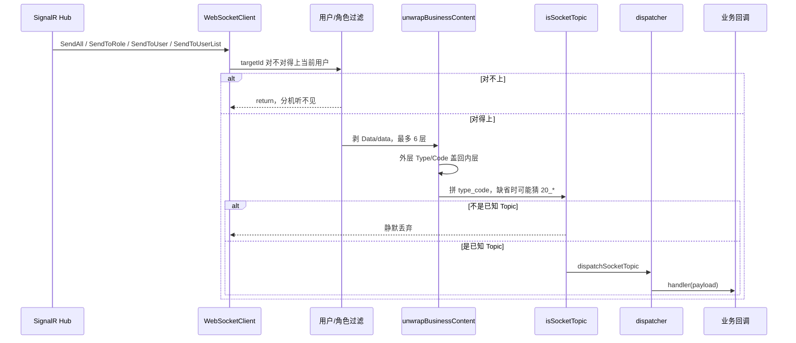
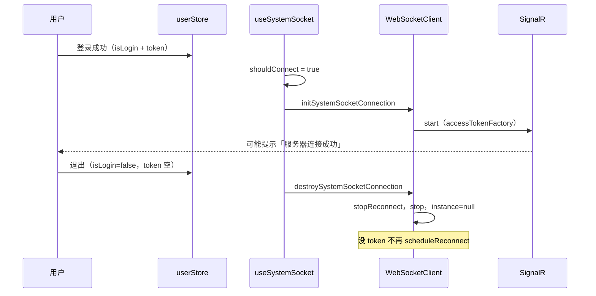
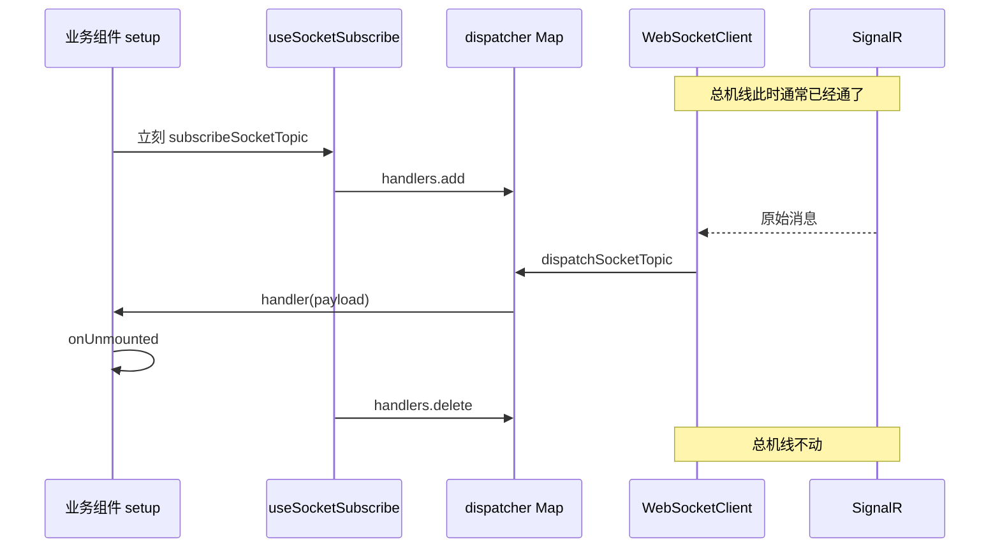

# 无人机：SignalR Topic 分发的实时基础设施

## 通俗讲解（易懂易输出）

核心就一句话：**全仓共用一根 SignalR 总机线；模板只负责接通、拆信封、按分机号喊人；业务自己决定听哪路、要不要扔掉别人的包。**

### 先用一个生活比喻

把整仓实时消息想成**公司总机**。

1. **总机线**（全局 SignalR）
  登录就插上。整栋楼共用这一根线。
   告警弹窗、监控页、导出、场景预览、主驾驶舱都用它。
   进业务页不是去接线，离页也不是拔总机。
2. **分机号**（Topic）
  线上一堆分机：`20_1` 是监控 OSD，`21_1` 是告警，`19_1` 是导出结果。
   前台只负责：来一条消息，按分机号喊对应的人。
3. **前台不认识你正在看哪台机**
  总机不知道你盯的是哪架无人机、等的是哪条导出任务。
   「是不是我的包」由各业务自己判断。
4. **自己接分机**（页面订阅）
  进页拿起听筒，离页挂上。
   挂分机 ≠ 拆总机。

记住这个比喻，后面都是它的展开。

### 出门能讲的 30 秒版

> 监控、告警、传输中心、场景预览共用同一个 Hub。
> 登录建一条全局 SignalR，退出才拆。业务页不另建连接。
> 消息外壳嵌套深、字段大小写不一，模板先拆信封，拼出 `type_code`，再变成 Topic。
> dispatcher 按 Topic 喊订阅方。业务只关心 Topic 和 payload。
> 进页立刻订、组件卸载才退；离页不拆总机。

能把这段背顺，笔记里 80% 的细节都能挂上去。

### 代码怎么分层（讲给别人听）

不要说「Socket 很复杂」。说三层：

1. **连上**
  `App.vue` 调一次 `useSystemSocket`。登录建、退出毁。全仓一条。
2. **送到哪类业务**
  信封里的 `type` + `code` 拼成 Topic。`19_*` 给传输中心，`20_*` 给监控，`21_1` 给告警，`22_1` 给主驾驶舱。
   分发器不认识「你正在看哪台」。
3. **业务自己过滤**
  监控页用「当前盯谁」丢掉别人的包。
   告警弹窗没有这一层：合法告警来了就展示。
   导出用 pending 任务对一下是不是自己发起的那条。

依赖方向没变：`views / components → hooks → utils/socket`。业务页禁止自己 `new` 一条连接。

### 从登录到业务页收到第一条消息（按现象记）

别先记文件名。先记你在屏幕上会看见什么。

1. **没登录**
  总机线不插。没 token 就不会建连。
2. **登录成功**
  右上角可能闪一下「服务器连接成功」。
   这时还没进任何业务页，线已经通了。
   顶栏通知一直在听 `21_1`，告警可以先弹。
3. **进某个业务页**
  页面拿起对应分机。监控拿 `20_*`，导出拿 `19_*`。
   拿分机不会再插一根线。
4. **Hub 推来一条原始消息**
  可能先到「发给所有人 / 某个角色 / 某个用户」。
   不是你的用户、不是你的角色，总机这层就挡掉，分机听不见。
5. **拆信封**
  外壳可能套了好几层 `Data` / `data`，字段可能是 `Type` 也可能是 `type`。
   模板拆完，拼出 `20_1` 这种分机号。
6. **对上分机号的人被喊到**
  监控回调里再问：这是不是我正在看的那台？
   告警回调里再问：这条 DTO 合不合法？
   导出回调里再问：是不是我还在等的那条任务？
7. **离开页面**
  放下分机。总机线还在。告警弹窗还在听。
8. **退出登录**
  这才拆总机。没 token 也不再重连。


### 四个重难点，改成「问题 → 答案」


#### 1. 为什么不每页自建一条 WebSocket / SignalR？

因为监控、告警、导出、场景预览共用同一个 Hub。
每页自建，登录态、重连、拆信封都要复制一遍，退出时也不知道该拆哪根。

模板已经有单例：类名叫 `WebSocketClient`，协议其实是 SignalR。
`useSystemSocket` 跟登录态；`useSocketSubscribe` 只管分机。

口诀：**一栋楼一根总机，进门接线出门拆线，进房间只拿分机。**

#### 2. 为什么消息要多层解包、还要统一大小写？

后端推过来的不是一张干净表。
字符串里可能再嵌 JSON；`Data` 里再套 `data`；`Type` 和 `type` 会换着来。

模板先拆到最里层，再把外层的 `Type` / `Code` 盖回去。
然后用 `type_code` 去对分机号。
对不上已知 Topic，这条消息就丢了，控制台也不一定看得到。

口诀：**外壳脏，先摊平再喊分机；大小写当同一套字段读。**

#### 3. dispatcher 为什么不认识「你正在看哪台机」？

因为它是总机前台，不是机房值班员。
它只知道：这条是 `20_1`，谁订了 `20_1` 就喊谁。

盯哪台、等哪条导出、告警合不合法，都是分机自己的事。
如果前台替你滤「哪台机」，告警和导出也要假装有一台机，分层就塌了。

口诀：**前台转分机，分机自己扔掉别人的包。**

#### 4. 退出登录 / 离开页面，分别拆掉什么？

两件不同的事，面试最爱混。

- **离开页面**：放下分机。`useSocketSubscribe` 在组件卸载时退订。总机还在。
- **退出登录**：拔总机。`isLogin` 或 token 空了，`useSystemSocket` 销毁单例。没 token 不重连。

进页不是建连，离页不是断线。

口诀：**离页挂分机，退出拆总机。**

### 方案为什么长这样（面试「为什么」）

不是从监控页倒推的。
是从这两条压出来的：

- **多业务共用一个 Hub。** 监控、告警、传输中心、场景预览都在这根线上。
- **消息外壳脏。** 嵌套深，字段大小写不一，有的包甚至不带 `Type` / `Code`。

所以模板要做成横切能力：单例、解包、Topic、登录态、自动卸载。
业务只加分机号和回调。

现在没做、但结构已经留口的：

- 未知 `type_code` 会被静默丢掉，以后要加新分机，先改 `topics.ts`
- 模板对「没写 Type、但长得像监控」的包，会按字段猜成 `20_1`～`20_4`
- `send()` 是空实现；页面要跟 Hub 说话，走的是 `invoke`，不是往总机线上塞字符串


### 合上书四句（建议原文能背）

1. 登录建一条全局 SignalR，业务页不另建连接
2. 信封解包后 `type_code` 变成 Topic，dispatcher 只按 Topic 喊人
3. 盯哪台、串台过滤都不在分发层
4. 离页只退订阅，退出登录才拆连接


### 自己输出时的填空稿

下次别人问「你们实时消息怎么做的」，按这个顺序说，不容易卡：

1. **多业务共用一个 Hub**，外壳还脏。
2. **模板建一条总机线**，登录建、退出毁。
3. **拆信封，拼** `type_code`**，变成 Topic。**
4. **dispatcher 按 Topic 喊人**，不认你盯哪台。
5. **业务自己订分机**：告警来了就展示，监控还要过滤，导出用 Socket 推状态机。
6. **离页挂分机，退出才拆线。** 不要每页自建。

---


## 模拟口述 2 分钟

按正常语速大约 2 分钟。按段落换气，中间不用看后面的详细笔记。

我们这套实时能力，说白了是在模板上建了一层横切的总机，不是每个业务页自己拉一根 WebSocket。

监控、告警弹窗、传输中心导出、场景预览、主驾驶舱，后端都走同一个 SignalR Hub。消息外壳嵌套深，字段有时大写有时小写。如果每页自建连接，登录态、重连、解包都得复制，退出时也不知道拆哪根。

所以 `App.vue` 调一次 `useSystemSocket`。登录且有 token 就建连，退出或 token 空了就销毁。类名叫 `WebSocketClient`，协议是 SignalR，全仓单例。重复 connect 会直接返回「已存在」。

消息进来先看是广播、按角色还是按用户。不是你的就挡掉。然后拆信封，最多往里剥六层 `Data` / `data`，同时把外层的 `Type` / `Code` 留下来。再拼 `type_code`。对上 `topics.ts` 里的分机号，才交给 dispatcher。对不上就丢掉，默认不打日志。

dispatcher 是内存里的发布订阅。它只按 Topic 喊人，不认识你正在看哪台机。业务页用 `useSocketSubscribe` 订分机：一进 setup 就订，组件卸载才退。离页不是拆总机。

两种消费者差很多。告警弹窗订一个 `21_1`，DTO 合法就展示。实时监控订多条 `20_*`，还要自己 invoke Hub 声明盯哪台，再在回调里过滤。导出是另一路：HTTP 先发起长任务，Socket 的 `19_*` 推着状态机往下走。同一根线，三种用法。

**卡住时就回这四句：**
登录建一条全局 SignalR，业务页不另建连接；信封解包后 `type_code` 变成 Topic，dispatcher 只按 Topic 喊人；盯哪台、串台过滤都不在分发层；离页只退订阅，退出登录才拆连接。

---

> 对照手册第二节第 3 条 + 阶段 3。基于仓库真实代码整理，模板 Socket 与业务消费者分开记。
> 证据主路径：`socket/index.ts` · `dispatcher.ts` · `topics.ts` · `useSystemSocket.ts` · `useSocketSubscribe.ts`

**合上书四句：** 登录建一条全局 SignalR，业务页不另建连接；信封解包后 `type_code` 变成 Topic，dispatcher 只按 Topic 喊人；盯哪台、串台过滤都不在分发层；离页只退订阅，退出登录才拆连接。

---


## 1. 代码地图

分层：**模板 Socket 负责「一条连接、拆信封、按 Topic 分发」；业务页负责「订哪个 Topic、payload 怎么用、要不要按身份过滤」。** 不要把后者说成模板独创。

```text
App.vue
  └─ useSystemSocket()                         登录即建连、退出即销毁
       └─ src/utils/socket/index.ts            类名 WebSocketClient，协议是 SignalR
            ├─ topics.ts                       分机号：19_* / 20_* / 21_1 / 22_1
            └─ dispatcher.ts                   内存 Map 发布订阅，不认业务身份

简单消费者
  useNotificationRealtime.ts                   只订 21_1，合法告警就展示

复杂消费者（对照，细节回监控笔记）
  useRealTimeMonitor.ts                        订 20_1～20_4，回调里再过滤
  realTimeMonitorSocket.ts                     Hub Subscribe / Unsubscribe + 过滤函数

HTTP + Socket 协作
  useExecutionRecordExport.ts                  订 19_2 + 19_1，推导出状态机
  useAlarmRecordExport.ts                      同一模式
  useTransmissionCenter.tsx                    订 19_2 + 19_3，改表格行
  useScenePreviewModel.ts                      订 19_1，等模型 URL

另一复杂消费者（点到）
  useCockpit.ts                                订 20_1 + 22_1
  main-cockpit-socket.ts                       SubscribeMainCockpit / SubscribeRealTimeMonitor
```


| 想改什么                 | 先动哪                                                       |
| -------------------- | --------------------------------------------------------- |
| 登录建连 / 退出销毁 / 关页重连   | `useSystemSocket.ts`                                      |
| 单例、解包、`type_code`、重连 | `src/utils/socket/index.ts`                               |
| 新增或改分机号              | `topics.ts`                                               |
| 谁被喊到、会不会漏退订          | `dispatcher.ts` + `useSocketSubscribe.ts`                 |
| 告警弹窗展示规则             | `useNotificationRealtime.ts`                              |
| 监控订哪些 Topic、怎么过滤     | `useRealTimeMonitor.ts`（过滤函数在 `realTimeMonitorSocket.ts`） |
| 导出 / 场景怎么等推送         | 各页自己的 `useXxxExport` / `useScenePreviewModel`             |
| 跟 Hub 声明「盯谁」         | 业务里的 `invokeSignalRHubMethodWhenReady`，不是 dispatcher      |


**代码里已确认的边界：**

- 业务页禁止另建连接。全仓只看到 `WebSocketClient.getInstance` / `initSystemSocketConnection`，没有页面自己 `new`。
- Hub 上的 `SubscribeRealTimeMonitor`、`SubscribeMainCockpit` 是业务 `invoke`，不是 Topic 分发。
- `initSystemSocketConnection` 传入的 `messageHandler` 是空函数。真正分发发生在 `dispatchBusinessMessage`。
- 监控页的切机、取流、飞控不是本篇主角，见 `docs/学习笔记-飞行实时监控多通道联动.md`。

---


## 2. 连接生命周期（对应用户操作流）

按时间写，不要按文件写。

1. **未登录**
  `shouldConnect` 为假。`useSystemSocket` 立刻 `destroySystemSocketConnection`。
   `connect()` 看见没有 token，也会 `close()`。
2. **登录成功**
  `userStore.login` 写入 token，并把 `isLogin` 置真。
   `watch(shouldConnect, { immediate: true })` 调 `initSystemSocketConnection()`。
   单例尚未存在就 `new`；已经连上就提示「连接已存在」然后返回。
   token 挂在 `accessTokenFactory` 上，会去掉开头的 `Bearer`。
3. **建连成功**
  屏幕可能看到「服务器连接成功」。
   这时还没有业务订阅也没关系。分机表是内存 Map，跟连接不是同一个对象。
4. **收到原始消息**
  Hub 四个接收方法：`SendAllAsync` / `SendToRoleAsync` / `SendToUserAsync` / `SendToUserListAsync`。
   广播直接过；按角色、按用户对不上当前登录人，这里就 return。
5. **解包 →** `type_code` **→ Topic**
  `unwrapBusinessContent` 往里剥。
   `Type`/`type` + `Code`/`code` 拼成 `20_1`。
   `isSocketTopic` 认得，才 `dispatchSocketTopic`。
6. **dispatcher 通知订阅者**
  同步遍历该 Topic 下的 handler。
   某个 handler 抛错只打日志，不影响别人。
7. **业务页进入 / 离开**
  进页：`useSocketSubscribe` 立刻把 handler 放进 Map。
   离页：组件 `onUnmounted` 才从 Map 删掉。
   这两步都不碰总机线。
8. **退出登录**
  `logOut` 把 `isLogin` 置假、`accessToken` 置空。
   `shouldConnect` 变假，销毁单例，`stopReconnect = true`。
   关标签、刷新前的 `pagehide` / `beforeunload` 也会拆线；`pageshow` 时若仍登录再接上。
9. **重连发生时，业务订户还在不在**
  还在。dispatcher 的 Map 不跟着 `disposeConnection` 清空。
   线重新接通后，原来订了 `21_1`、`20_4` 的人继续被喊。
   不必为了重连再调一次 `useSocketSubscribe`。
   但 Hub 上的「我盯哪台」是 `invoke`，断线后后端是否还记得，本篇不展开；监控笔记写的是业务自己重新 Subscribe。


| 这件事             | 谁做                                    | 用户动作            | 拆掉它要做什么                          |
| --------------- | ------------------------------------- | --------------- | -------------------------------- |
| 建连              | `useSystemSocket` → 单例 `connect`      | 登录 / 刷新后仍登录     | 退出登录，或关页                         |
| 订阅 Topic        | `useSocketSubscribe` → dispatcher Map | 进入会调用该 hook 的组件 | 组件卸载（不是路由一变就拆线）                  |
| invoke Hub 业务方法 | `invokeSignalRHubMethodWhenReady`     | 选中某台机、进驾驶舱等     | 业务自己 Unsubscribe；跟 dispatcher 无关 |


---


## 2.1 一条消息从 Hub 到业务回调（逐步）

你在控制台可能先看到的是连接成功，而不是每条推送。
真正走到业务回调，顺序是固定的。




逐步对应代码：

1. `handleHubEvent` 兼容「只有 payload」和「targetId + payload」两种参数。没 token 直接 return。
2. `shouldHandleMessage`：广播放行；角色、用户、用户列表对不上就挡。这是总机接线员，还不是分机号。
3. `unwrapBusinessContent`：字符串先 `JSON.parse`；有 `Data`/`data` 就继续往里走，深度超过 6 停。
4. `mergeEnvelopeMeta` 把外层的 `Type`/`type`、`Code`/`code` 写到内层对象上。**大小写不统一的字段在这一层被摊平到同一套键上。**
5. `dispatchBusinessMessage` 再读一次 `Type ?? type`、`Code ?? code`。
6. 两者都缺、但内容长得像监控包（有 `osd` / `item` / `items` / `drone` / `dock`），模板会猜成 `20` 和 `1`～`4`。
7. 拼出 `socketKey`。`isSocketTopic` 为真才分发。
8. **未知** `type_code` **的命运：不 dispatch，也不打日志。** 等于这条分机号在本公司不存在，前台把纸条扔了。

```336:364:src/utils/socket/index.ts
  private dispatchBusinessMessage(payload: unknown): void {
    const content = unwrapBusinessContent(payload)

    let messageType = content?.Type ?? content?.type
    let messageCode = content?.Code ?? content?.code

    if (
      messageType == null &&
      ('osd' in content ||
        'item' in content ||
        'items' in content ||
        'drone' in content ||
        'dock' in content)
    ) {
      messageType = 20
    }
```

缺 `messageCode` 且已是 `20` 时，再按 `osd`→1、`item`→2、`items`→3、`drone|dock`→4 补上。最后拼 `socketKey`，只有 `isSocketTopic` 为真才 `dispatchSocketTopic`。

业务回调拿到的仍可能带着一层外壳。所以监控、驾驶舱、场景里还有各自的 `normalize*`。
那是分机自己再拆一遍，不是总机漏做。手册说的「多层 unwrap / normalize」要拆开记：模板叫 `unwrapBusinessContent`，`normalize*` 在业务层。

---


## 3. 重难点（4 条）


### 3.1 为什么不每页自建连接

**问题：** 每个实时页自己 `new` 一条 WebSocket / SignalR，不好吗？

**错误理解：** 页面有推送需求，就该自己管连接。监控页最复杂，更该独立一条。

**代码怎么挡：**

- 构造函数是 `private`，只许 `getInstance`。
- 已有实例时，只更新 `messageHandler`；url 变了才重 `init`。
- `connect`：正在连、已经 Connected、没有 token，三种都不会再开第二根。
- 真正的入口只有 `App.vue` 的 `useSystemSocket`。

```112:125:src/utils/socket/index.ts
  static getInstance(options: WebSocketOptions): WebSocketClient {
    if (!WebSocketClient.instance) {
      WebSocketClient.instance = new WebSocketClient(options)
    } else {
      WebSocketClient.instance.messageHandler = options.messageHandler
      if (options.url && WebSocketClient.instance.url !== options.url) {
        WebSocketClient.instance.url = options.url
        WebSocketClient.instance.reconnectAttempts = 1
        WebSocketClient.instance.init()
      }
    }

    return WebSocketClient.instance
  }
```

```171:185:src/utils/socket/index.ts
  private async connect(resetReconnectAttempts = false): Promise<void> {
    if (this.isConnecting) {
      console.log('正在建立SignalR连接中...')
      return
    }

    if (this.connection?.state === HubConnectionState.Connected) {
      console.warn('SignalR连接已存在')
      return
    }

    if (!this.accessToken) {
      this.close()
      return
    }
```

页面要跟 Hub 说话，用现成单例的 `invoke`，等连接就绪最多试 20 次、间隔 250ms。不要自己再 `HubConnectionBuilder`。

口诀：**一栋楼一根总机，进门接线出门拆线，进房间只拿分机。**

### 3.2 为什么要多层解包、还要统一大小写

**问题：** 后端都推 JSON 了，为什么还要剥六层？

**错误理解：** 业务页自己 `payload.data.Type` 取一下就行。或者模板已经摊平，业务不必再读大小写。

**代码怎么挡：**

- `parseJsonValue`：整段还是字符串，就再 parse 一次。
- `unwrapBusinessContent` 沿 `Data ?? data` 往下走，并把外层 Type/Code 盖回内层。
- `dispatchBusinessMessage` 再读一遍 `Type ?? type`。
- 监控外形的兜底：没 Type 也要尽量进 `20_*`，否则这些包会变成未知 Topic 被扔掉。

```54:72:src/utils/socket/index.ts
const unwrapBusinessContent = (payload: unknown, depth = 0): Record<string, unknown> => {
  if (depth > 6 || payload == null) return {}

  const current = parseJsonValue(payload)
  if (typeof current !== 'object' || Array.isArray(current)) return {}

  const record = current as Record<string, unknown>
  const nested = record.Data ?? record.data

  if (nested == null) return record

  const inner = unwrapBusinessContent(nested, depth + 1)

  if (Object.keys(inner).length > 0) {
    return mergeEnvelopeMeta(inner, record)
  }

  return record
}
```

告警回调里仍然同时写了 `type` / `Type`，并用 `payload.data` 兜一层。
这不是重复劳动，是「总机保证能喊到分机，分机保证能读到业务字段」。

口诀：**外壳脏，先摊平再喊分机；大小写当同一套字段读。**

### 3.3 dispatcher 为什么不做「盯哪台」

**问题：** 过滤放在分发器里，监控页不是更干净吗？

**错误理解：** Topic 分发就该把串台挡掉。`21_1` 和 `19_1` 也可以顺便带一个设备号。

**代码怎么挡：**

- dispatcher 的 Map 只有 `Topic → Set<handler>`。没有订阅上下文，没有 `droneId`。
- `dispatchSocketTopic` 有人订就喊，没人订就 return。
- 监控的闸门在业务回调第一行：`isPushForSubscription`。
- 告警、导出根本没有「当前盯哪台」。

```29:39:src/utils/socket/dispatcher.ts
export function dispatchSocketTopic<T = unknown>(topic: SocketTopic, payload: T) {
  const currentHandlers = subscribers.get(topic)
  if (!currentHandlers?.size) return

  currentHandlers.forEach((handler) => {
    try {
      void handler(payload)
    } catch (error) {
      console.error(`[socket-dispatcher] topic ${topic} 处理失败:`, error)
    }
  })
}
```

```76:78:src/views/flight-dashboard/real-time-monitor/modules/useRealTimeMonitor.ts
  useSocketSubscribe(SOCKET_TOPIC.REAL_TIME_MONITOR_PANEL, (payload) => {
    if (!isPushForSubscription(payload, activeSubscription.value)) return
```

`isPushForSubscription` 对的是电站 + 巡视设备，这是监控页的身份，不是总机的身份。
切机、串台细节回监控笔记第 3.1 节。这里只需能指着：闸门不在 dispatcher。

口诀：**前台转分机，分机自己扔掉别人的包。**

### 3.4 离页拆订阅，退出才拆连接

**问题：** 离开监控页，全局 Socket 是不是该断？

**错误理解：** 页面走了连接就该停，不然浪费。或者反过来：退出登录只要清 token，连接可以留着。

**代码怎么挡：**

- `useSocketSubscribe` 立刻 `subscribeSocketTopic`，只在 `onUnmounted` 里退。
- `useSystemSocket` 看的是 `isLogin && accessToken`，变假才 `destroyInstance`。
- `close()` 会 `stopReconnect = true`。没 token 的 `shouldSkipReconnect` 也不会再拨。
- 关页：`pagehide` / `beforeunload` 拆线；`pageshow` 仍登录再接。

```5:15:src/hooks/core/useSocketSubscribe.ts
export function useSocketSubscribe<T = unknown>(topic: SocketTopic, handler: (payload: T) => void) {
  const unsubscribe = subscribeSocketTopic(topic, handler)

  onUnmounted(() => {
    unsubscribe()
  })

  return {
    unsubscribe
  }
}
```

```22:33:src/hooks/core/useSystemSocket.ts
  watch(
    shouldConnect,
    (canConnect) => {
      if (canConnect) {
        initSystemSocketConnection()
        return
      }

      destroySystemSocketConnection()
    },
    { immediate: true }
  )
```

还有一个坑，要主动说：它**没有** `onDeactivated`。
布局里 `route.meta.keepAlive` 为真时会包 `KeepAlive`。告警记录、传输中心静态路由都是 `keepAlive: true`。
这种页切走时组件可能还活着，分机不会挂。对「等导出结果」有时是好事；不要说成「离页一定退订」。

口诀：**离页挂分机，退出拆总机。**

---


## 4. 实时基建时序


### 4.1 登录建连 / 退出销毁




`App.vue` 第 26 行调一次 `useSystemSocket()`。
默认 Hub 路径是 `/lidar-notify-hub`，开发代理在 `vite.config.ts` 里开了 `ws: true`。
`useSystemSocket` 没有把别的 url 传进去，所以连的就是这条默认路径。

### 4.2 进业务页订阅 → 收到一条 Topic → 离页卸载




订分机不需要连接已经 Connected。
线后通，Map 里的人照样被喊。这就是「订阅」和「建连」拆开的好处。

### 4.3 断线重连时，订户要不要重订

**Topic 订户：不用重订。** Map 还在。

**Hub 业务方法：那是另一件事。** 监控重新 `SubscribeRealTimeMonitor` 是业务生命周期，不是 dispatcher 的职责。

重连本身有两套，面试别说成「指数退避」：

- SignalR 建连时开了 `withAutomaticReconnect()`，具体退避参数代码没再配，以库默认行为为准。
- `onclose` 之后还有自己的 `scheduleReconnect`：间隔默认 **5 秒**，最多 **10 次**，**不是指数退避**。
- 没 token，或 `close()` 把 `stopReconnect` 置真，不重连。
- 超过 10 次会 `close(true)`，停掉。
- `reconnectTimeout` 只赋了默认 30 秒，**调度函数里没有读它**。

```151:158:src/utils/socket/index.ts
  private buildConnection(): HubConnection {
    console.log('this.url:', this.url)
    const connection = new HubConnectionBuilder()
      .withUrl(this.url, {
        accessTokenFactory: () => this.accessToken
      })
      .withAutomaticReconnect()
      .build()
```

```382:404:src/utils/socket/index.ts
  private async scheduleReconnect(): Promise<void> {
    if (this.shouldSkipReconnect()) {
      this.resetReconnectState()
      return
    }

    if (this.reconnectTimer) {
      return
    }

    if (this.reconnectAttempts > this.maxReconnectAttempts) {
      console.error(`已达到最大重连次数(${this.maxReconnectAttempts})，停止重连`)
      await this.close(true)
      return
    }
```

间隔用的是 `this.reconnectInterval`（默认 5 秒），不是指数退避。

---


## 5. Topic 一览

源：`src/utils/socket/topics.ts`。下面「谁订阅」只记代码里真实的 `useSocketSubscribe` 调用点。


| Topic  | 人话       | 谁订阅                                              | payload 用途（一句话）          | 是否还要额外 Hub 方法            |
| ------ | -------- | ------------------------------------------------ | ------------------------ | ------------------------ |
| `19_1` | 传输中心导出更新 | 执行记录导出、告警导出、场景预览                                 | 导出/取链完成后的状态或 AccessUrl   | 否                        |
| `19_2` | 传输中心导入更新 | 执行记录导出、告警导出、传输中心页                                | 执行记录注释写明：下载完成走它；页内用来补行状态 | 否                        |
| `19_3` | 传输中心进度   | 仅传输中心页                                           | 刷新表格行的进度 / 状态名           | 否                        |
| `20_1` | 监控 OSD   | 实时监控、主驾驶舱                                        | HUD：电量、速度、高度等            | 是，业务自己 Subscribe*        |
| `20_2` | 监控抓拍     | 实时监控                                             | 写入抓拍列表；页面挂不挂回监控笔记        | 是，同上                     |
| `20_3` | 监控时间轴    | 实时监控                                             | 整表替换时间轴                  | 是，同上                     |
| `20_4` | 监控面板     | 实时监控                                             | 左栏无人机 / 机巢               | 是，同上                     |
| `21_1` | 告警弹窗新建   | 顶栏 `ArtNotification` → `useNotificationRealtime` | 合法告警进 store / 弹窗         | 否                        |
| `22_1` | 主驾驶舱态势   | `useCockpit`                                     | 解析成遥测：坐标、航迹、在线           | 是，`SubscribeMainCockpit` |


补充，避免背错：

- **没有「已定义、完全没消费者」的 Topic。** `topics.ts` 里 9 个值都能指到订阅点。
- 传输中心页**没有订** `19_1`。`19_1` 给导出和场景预览。
- 手册常写「场景下载」。代码落点是 `useScenePreviewModel.ts`：预览模型时等 `19_1` 把文件 URL 推回来。另有 `USE_LOCAL_DEMO_MODEL`，本地联调可以不走这条推送。
- Hub 接收方法是 `Send*Async`，不是 Topic。Topic 是拆完信封之后的分机号。

```1:13:src/utils/socket/topics.ts
export const SOCKET_TOPIC = {
  TRANSMISSION_CENTER_EXPORT_UPDATE: '19_1',
  TRANSMISSION_CENTER_IMPORT_UPDATE: '19_2',
  TRANSMISSION_CENTER_PROGRESS_UPDATE: '19_3',
  REAL_TIME_MONITOR_OSD: '20_1',
  REAL_TIME_MONITOR_CAPTURE: '20_2',
  REAL_TIME_MONITOR_TIMELINE: '20_3',
  REAL_TIME_MONITOR_PANEL: '20_4',
  /** 告警消息弹窗：新建未处置推送 type=21 code=1 */
  ALARM_POPUP_CREATED: '21_1',
  /** 主驾驶舱态势：type=22 code=1 */
  MAIN_COCKPIT_TELEMETRY: '22_1'
} as const
```

---


## 6. 两对容易混的概念（面试易混）

其实是三对。第一对最容易把整层讲塌。

### 连接 vs 订阅（插座 vs 分机）


|     | 连接（总机线）            | 订阅（分机）                            |
| --- | ------------------ | --------------------------------- |
| 对象  | `HubConnection` 单例 | dispatcher 里的 handler             |
| 何时有 | 登录且有 token         | 组件 setup 调用了 `useSocketSubscribe` |
| 何时无 | 退出、关页、销毁单例         | `onUnmounted` 或不小心忘了退             |
| 忘了拆 | 退出后还可能重连、占着 Hub    | 人走了回调还在，轻则浪费，重则写到已卸载的状态           |


进监控页不是去插电。离监控页也不是拔插座。

### Topic 分发 vs 业务过滤（总机转分机 vs 分机扔掉别人的包）


|      | Topic 分发                               | 业务过滤                                                 |
| ---- | -------------------------------------- | ---------------------------------------------------- |
| 问的问题 | 这是哪一类业务？                               | 这是不是我正在处理的那一条？                                       |
| 典型代码 | `dispatchSocketTopic('20_1', content)` | `isPushForSubscription` / 告警 `id+level` / 导出 pending |
| 放哪   | `utils/socket`                         | 各业务 hook                                             |
| 不该做的 | 认识电站、无人机、导出任务号                         | 自己再 `new` 一条连接                                       |


### Hub invoke 业务方法 vs 收消息 Topic（「我声明盯谁」vs「推送分类」）


|       | invoke Hub                                          | Topic                        |
| ----- | --------------------------------------------------- | ---------------------------- |
| 方向    | 前端主动喊后端                                             | 后端推到前端再分类                    |
| 例子    | `SubscribeRealTimeMonitor`、`SubscribeMainCockpit`   | `20_4`、`22_1`                |
| 谁封装   | 业务 `*Socket.ts` + `invokeSignalRHubMethodWhenReady` | 模板 `dispatchBusinessMessage` |
| 没做会怎样 | 后端可能少推你要的那台                                         | 推上来了也没人接，或接到了却对不上分机号         |


监控页可以先订好四条 Topic，但 `activeSubscription` 为空时推送全丢。
所以「分机已拿起」不等于「我已经声明盯这台」。

主驾驶舱还会 `invoke('SubscribeRealTimeMonitor', patrolDeviceCode)`，参数个数和监控页的「电站 + 巡视设备」不一样。
本篇只记一句：invoke 的签名是业务约定，不是 dispatcher 的协议。

---


## 7. 三层分工（模板 + 业务）


| 层         | 解决什么                                    | 不解决什么                              | 典型文件                                                |
| --------- | --------------------------------------- | ---------------------------------- | --------------------------------------------------- |
| 单例连接      | 一条 Hub、token、重连、退出销毁、给业务一个 `invoke` 入口  | 订哪个 Topic、payload 怎么展示、盯哪台         | `socket/index.ts`、`useSystemSocket.ts`、`App.vue`    |
| Topic 分发  | 拆信封、拼 `type_code`、按 Topic 喊人、组件卸载退订     | 用户正在看哪台、导出任务是否 pending、告警 level 策略 | `topics.ts`、`dispatcher.ts`、`useSocketSubscribe.ts` |
| 业务过滤 / 协作 | 选 Topic、用 payload、必要时报名 Hub、和 HTTP 拼状态机 | 复制建连、自己解一层总信封当连接层                  | 告警 hook、监控 hook、导出 hook、场景预览、驾驶舱                    |


新实时能力默认只做两件事：

1. `topics.ts` 加一个分机号（如果后端给了新的 type/code）。
2. 某个 hook 里 `useSocketSubscribe`，在回调里用 payload。

不要复制 `WebSocketClient`，不要在页面里 `HubConnectionBuilder`。
需要「我盯谁」时，再在业务里 `invoke`，仍然走现成单例。

---


## 8. 简单消费者 vs 复杂消费者

同一根总机线，用法差一截。用来证明分层，不把监控页再讲一遍。


|                | 告警弹窗                     | 实时监控                         | 传输中心导出                  |
| -------------- | ------------------------ | ---------------------------- | ----------------------- |
| 订几个 Topic      | 1 个：`21_1`               | 4 个：`20_1`～`20_4`            | 2 个：`19_2` + `19_1`（兼容） |
| 要不要 invoke Hub | 否                        | 要，`SubscribeRealTimeMonitor` | 否                       |
| 过滤什么           | DTO 有 `id`，level 是 1/2/3 | 「当前盯的电站 + 巡视设备」              | pending 任务是不是这条         |
| 和 HTTP 的关系     | 开窗后再拉列表是另一条路             | panel / play / command 是旁路   | HTTP 先发起，Socket 推着下载    |
| 复杂度            | 简单消费者                    | 复杂消费者                        | HTTP + Socket 状态机       |


**告警弹窗。**
挂在顶栏 `ArtNotification`，跟布局走，不是某张业务页。
来一条 `21_1`，抽得出告警且 level 合法：level 3 自动开窗；提醒/通知只在面板打开时更新。
它不声明「看哪台」。

```37:46:src/components/core/layouts/art-notification/hooks/useNotificationRealtime.ts
  useSocketSubscribe(SOCKET_TOPIC.ALARM_POPUP_CREATED, (payload: AlarmPopupSocketPayload) => {
    const alarm = extractAlarmFromPayload(payload)
    if (!alarm) return

    if (alarm.level === 3) {
      alarmStore.applyCreatedAlarm(alarm)
      options.onSwitchToAlarmTab()
      options.onPrepend(alarm)
      return
    }
```

**实时监控。**
订多路 Topic，还要 Hub 报名、页面过滤、HTTP 取流。
取流、切红外、`requestToken`、飞控二次确认，见监控笔记第 2～6 节。
本篇只记住：过滤函数在 `realTimeMonitorSocket.ts`，不在 dispatcher。

**传输中心导出。**
执行记录、告警记录都是：HTTP 先丢一个长任务进 pending，再听 `19_2` / `19_1`，按 `OperationState` 往下走。
传输中心页自己听 `19_2` / `19_3`，用来改表格行，不发起「我这份 Excel」。
这证明基建可以并行扩展：新能力加 Topic 和回调，不复制连接。

**场景预览。**
`useScenePreviewModel.ts` 订了 `19_1`。详情里没有直接 URL 时，用传输中心记录 id 去等推送里的文件地址。
手册说的「场景下载共用 Hub」，代码证据在这里。它不是另建连接的场景下载器。
本地 Demo 开关打开时，这条推送可以不走，口述要主动说边界。

**主驾驶舱。**
`useCockpit` 订 `20_1` 和 `22_1`，并 invoke `SubscribeMainCockpit`。
也是复杂消费者，证明 `22_1` 不是死常量。本篇不展开驾驶舱飞控。

---


## 9. 口述卡（背景 → 方案 → 结果）

**背景**  
监控、告警、传输中心导出、场景预览共用同一个 Hub。消息外壳嵌套深，字段大小写不一。如果每页自建连接，登录态和重连会散掉。

**方案**  
在模板上做横切能力，而不是从零搭脚手架：单例 SignalR + 信封解包 + `type_code` → Topic + 内存 dispatcher + `useSystemSocket` 跟登录态 + `useSocketSubscribe` 自动卸载。业务只选 Topic、消化 payload；需要「盯谁」再 invoke Hub。

**结果（可验证，不编数字）**  
业务页不复制连接逻辑。新实时能力默认加 Topic 和一个订阅方。连接生命周期统一：登录建、退出毁。告警、监控、导出三种消费者能并行挂在同一根线上。

**追问锚点**

- 为什么不每页自建？→ `WebSocketClient.getInstance`、`useSystemSocket`、`useSocketSubscribe`、`topics.ts`。
- dispatcher 为何不做串台过滤？→ Map 里只有 Topic；闸门在业务回调，例如 `isPushForSubscription`。
- 离页会不会把全局 Socket 拆掉？→ 不会。离页退的是 handler，退出登录才 `destroyInstance`。

---

